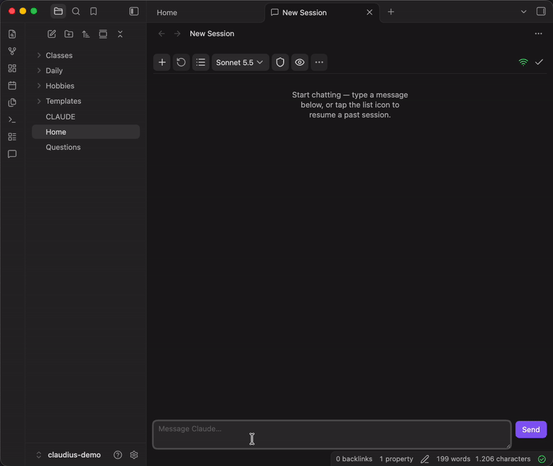

# Claudius Chat for Obsidian

Claudius Chat is a sidebar for Obsidian that lets you chat with Claude on desktop and phone. Claudius runs the agent on a server you host, so your sessions keep going when your device sleeps.



Claudius Chat puts the [Claude Code](https://code.claude.com/docs/en/overview) agent, which can read, search and edit the notes in your vault, behind a chat UI instead of a terminal. Replies and thinking stream in, tool calls and the agent's todo list are shown, and anything destructive waits for your **Allow** or **Deny**.

- **Sessions live on the server, not in the app.** Close Obsidian, lock your phone or switch device, and pick up where the session is.
- **Works on iOS and Android.** The plugin is DOM and WebSocket only. (Only tested on iOS so far)
- **Same sessions as the `claude` CLI.** Resume a chat in your terminal, or the other way round.
- **Private.** No cloud service, no telemetry. Your devices talk to your server over your own Tailscale network.

## Before you start

This is self-hosted. It needs a small server of your own, not just a plugin install. You need:

1. **A host that stays on**: Linux is tested; macOS should work but is untested; Windows is not supported. Node.js 20 or newer.
2. **Claude Code, signed in on that host**. Claude subscription works (see [Subscription use](#subscription-use)).
3. **A copy of your vault on the host**, kept in sync with your devices by whatever you already use (Obsidian Sync, Syncthing, git, ...). The agent edits the host's copy; your sync carries the edits back.

**[Tailscale](https://tailscale.com)** on the host and on every device you chat from is optional but **strongly** recommended.

Without the server the plugin is an empty sidebar. It cannot talk to Claude by itself.

```
 Obsidian (desktop / phone)                always-on host
 ┌────────────────────────┐   ws://      ┌──────────────────────────────┐
 │  Claudius Chat plugin  │ ──────────▶  │  Claudius Chat server        │
 │  (sidebar view)        │  Tailscale   │  (owns the sessions, runs    │
 └────────────────────────┘   + token    │   Claude Code via Agent SDK) │
                                         └──────────────────────────────┘
        your vault  ⇄  your file sync  ⇄  vault copy on the host
```

## Quick start

**1. Tailscale.** Install it on the host and on each device and run `tailscale up`. On the host, note its address with `tailscale ip -4`. Again: This is optional, but strongly recommended.

**2. Server, on the host.**

```bash
git clone https://github.com/benjmin-r/obsidian-claudius-chat.git ~/projects/obsidian-claudius-chat
cd ~/projects/obsidian-claudius-chat
npm install
npm run build -w @occ/protocol && npm run build -w @occ/server

cp packages/server/occ-server.env.example ~/.config/occ-server.env
chmod 600 ~/.config/occ-server.env
```

Edit `~/.config/occ-server.env` and set `OCC_TOKEN` (generate one with `openssl rand -hex 32`), `OCC_HOST` (the Tailscale address from step 1) and `OCC_VAULT_CWD` (the vault copy on the host). Then start it:

```bash
node --env-file="$HOME/.config/occ-server.env" packages/server/dist/index.js
# [occ] listening on ws://100.x.y.z:8765 (cwd=..., model=...)
```

That is enough to try it. To keep it running across reboots, set it up as a service: see [docs/SERVER.md](docs/SERVER.md).

**3. Plugin, in each vault.** Until the plugin is in the community directory, install it with [BRAT](https://github.com/TfTHacker/obsidian42-brat), a community plugin that installs plugins straight from GitHub releases and keeps them updated (it works on iOS and Android too):

1. Install **BRAT** from **Settings → Community plugins → Browse**.
2. In BRAT's settings, select **Add beta plugin** and enter `benjmin-r/obsidian-claudius-chat`.
3. Enable **Claudius Chat** under **Settings → Community plugins**.
4. Open **Settings → Claudius Chat** and set **Server URL** (`ws://<tailscale-ip>:8765`, or your host's `.ts.net` name) and **Bearer token** (the same `OCC_TOKEN`).

<!-- When the plugin is accepted into the community directory, replace step 3's BRAT instructions with: Settings → Community plugins → Browse → "Claudius Chat" → Install. -->

**4. Check it works.** Select the message icon in the ribbon (or run **Claudius Chat: Open chat**) and send "hello". The connection icon in the chat toolbar should show that you are connected. If it isn't, see [Troubleshooting](#troubleshooting).

## Using it

- **Chat:** Enter sends, Shift+Enter adds a line. Type `@` to mention a note from your vault.
- **Pick the model, reasoning level and permission mode** from the toolbar. New sessions use the defaults in **Settings → Claudius Chat**.
- **Sessions:** switch, rename, archive or delete them from the session list. Sessions keep running when the app closes.
- **Share a conversation:** **Export to Markdown** saves a session as a note, and **Insert link to a Claude conversation** puts a link to a chat (or a single message) in the note you are editing.
- **Stop** interrupts the current turn. **Reload** re-reads a session from disk.

## What the agent can do to your notes

The agent is Claude Code: it can read, create and edit files and **run shell commands**, as the user the server runs as, with your vault as its working directory. It is not sandboxed to the vault.

- **Default behaviour ("Confirm destructive actions"):** edits and new files are applied straight away. Shell commands that delete, move or overwrite (`rm`, `mv`, a truncating `>`, `git reset --hard`, force-push, and similar) stop and ask for **Allow** or **Deny**. This is a deliberately small list of patterns, not a guarantee. Keep backups or version history of your vault.
- **Other modes:** "Auto-accept edits", and "Auto", where Claude decides and asks only when unsure.
- **Who can reach it:** the server only listens on your Tailscale address and every connection needs the bearer token. Anyone on your tailnet who has the token can drive the agent, so treat it like a password. More in [docs/SERVER.md](docs/SERVER.md#security).

## Network use and disclosures

- **Network use.** The plugin makes one kind of connection: a WebSocket to **your own server**, at the address you enter in settings, over your Tailscale network. It contacts no other service, sends **no telemetry or analytics**, and never updates itself. All requests to Claude come from your server, not from the plugin.
- **Account required.** Full functionality needs the server above and a Claude subscription signed in on that host.
- **Files.** The plugin only reads its own settings. The agent's file access happens on the server, inside your vault copy.
- **Unofficial.** This is an independent community project, not affiliated with, endorsed by or sponsored by Anthropic. "Claude" is a trademark of Anthropic, used here only to say what the plugin connects to.

### Subscription use

The server uses your own Claude login and you sign in through Claude Code on your own host, whether via a subscription, API keys or 3rd party like AWS Bedrock. 

As I read Anthropic's documentation, using your Claude subscription in this way is covered, and the thing it prohibits is the opposite (routing other people's requests through subscription credentials). See the note in the [Agent SDK overview](https://code.claude.com/docs/en/agent-sdk/overview), [Legal and compliance: authentication and credential use](https://code.claude.com/docs/en/legal-and-compliance#authentication-and-credential-use), and the Help Center article [Use the Claude Agent SDK with your Claude plan](https://support.claude.com/en/articles/15036540) (checked 2026-11-16).
If you want to build something for other people, use API keys not a subscription.

## Troubleshooting

| What you see | Likely cause and fix |
|---|---|
| "No server URL configured" or "Invalid server URL" | Set **Server URL** in **Settings → Claudius Chat**, like `ws://100.x.y.z:8765`. |
| "Invalid token" and no reconnecting | The token differs from `OCC_TOKEN`. Fix it in settings; the plugin reconnects. |
| Disconnected icon, nothing else | The server is down, Tailscale is off on the host or this device, or the address or port is wrong. On the host run `tailscale status` and `journalctl -u occ-server -f`. |
| Connects, but messages fail | Claude Code isn't signed in for the user the server runs as. Run `claude` as that user. |
| Chat is read-only with a lock banner | The same session is open in a terminal. Close it there, then select **Reload**. See [docs/CLI_INTEROP.md](docs/CLI_INTEROP.md). |
| Agent's edits don't show on another device | That is your file sync. This project doesn't sync files. |
| An old session is missing from the list | The list shows only the 50 most recently modified sessions. |

## Status

Version 0.1, used daily by its author. Expect rough edges, especially on mobile and when it comes to layout and design. Bug reports are welcome on the [issue tracker](https://github.com/benjmin-r/obsidian-claudius-chat/issues).

## More

- [Server reference](docs/SERVER.md): service setup, all settings, several vaults, security, updating
- [Using the `claude` CLI in the same vault](docs/CLI_INTEROP.md)
- [Security policy](SECURITY.md)
- [Contributing](CONTRIBUTING.md), [architecture decisions](TECHNICAL_DECISIONS.md) and [releasing](docs/RELEASING.md)

## License

[MIT](LICENSE)
